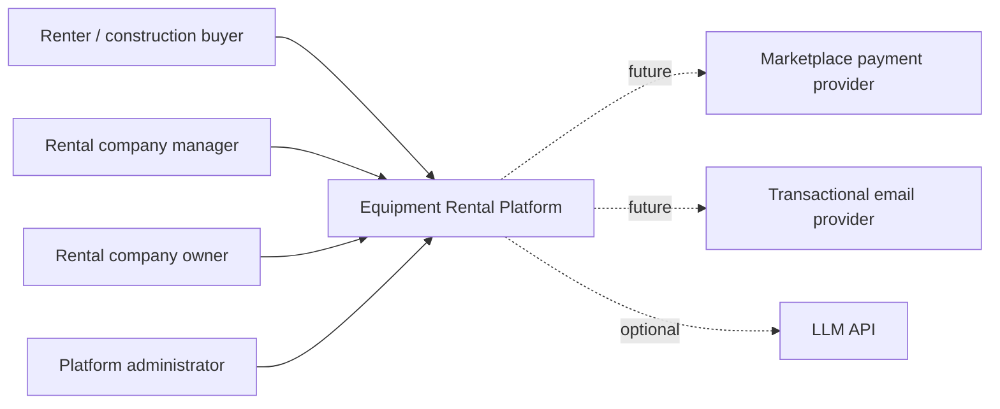
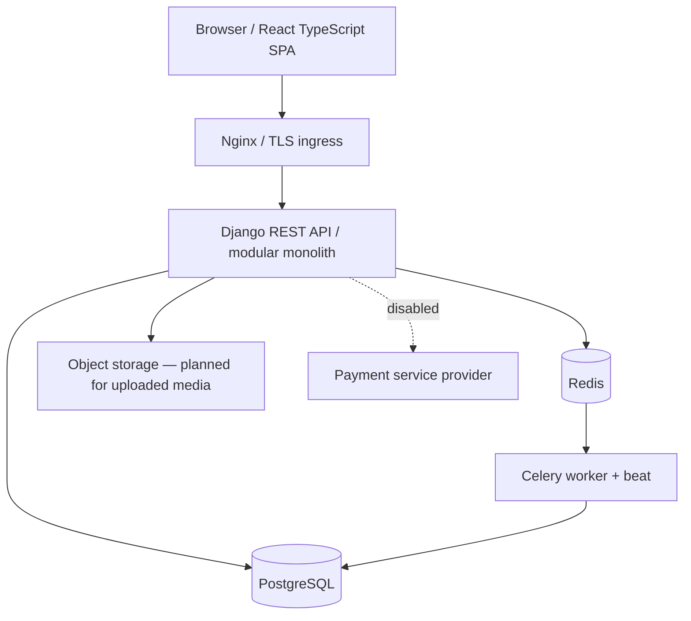
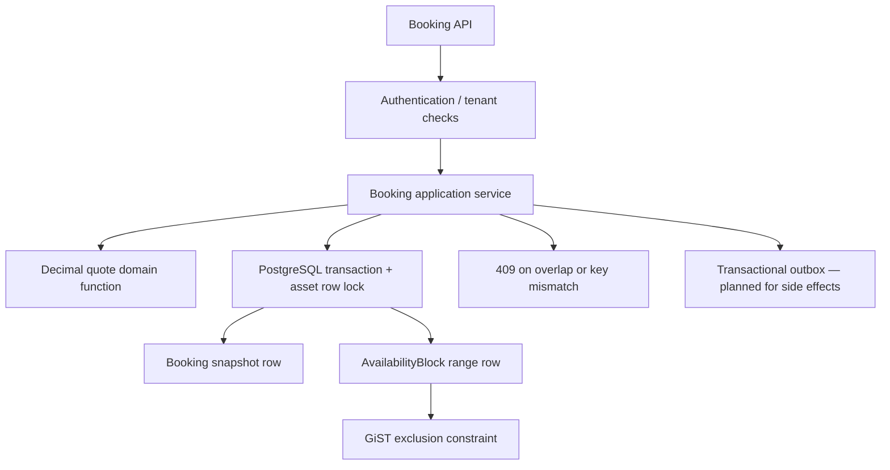

# C4 diagrams

## Level 1 — System context

## Level 2 — Containers

## Level 3 — booking module

## Limitations

The diagrams describe intended and source-level boundaries, not proof that every container or module is deployed. Object storage, provider integrations, observability exporter and durable outbox dispatch are not wired in this tranche.
