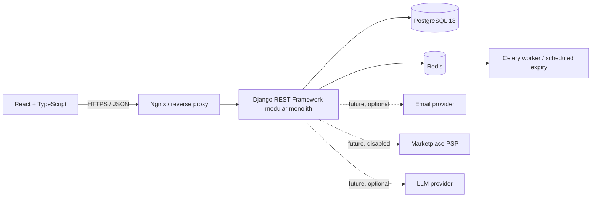

# Architecture overview

## Context and drivers

The product connects business renters and equipment-owning companies. Core quality attributes are tenant isolation, reliable time-window allocation, immutable price snapshots, auditability, and operational simplicity for a small team.

## Architecture

## Modules

- **accounts:** identity, session login and profile basics.
- **organizations:** companies and memberships (owner/manager).
- **inventory:** catalogue, location, categories, typed characteristics, photos and rate history.
- **bookings:** pricing snapshot, booking state, shared availability blocks, cancellations and maintenance.
- **payments:** payment/refund/webhook schema only; provider integration remains disabled.
- **operations:** reviews, complaints and transactional outbox.
- **audit:** request correlation and audit events.

## Key decision: modular monolith

One deployable backend preserves transaction boundaries around booking and availability. Separate services would add distributed consistency and operations overhead before a demonstrated scale requirement. Modules keep domain boundaries explicit and allow extraction later if measured load or team ownership justifies it.

## Booking concurrency invariant

A PostgreSQL `tstzrange` allocation row covers both a booking and a maintenance window. A GiST exclusion constraint rejects active rows where equipment IDs match and time ranges overlap. This is stronger than checking availability and then inserting: the database protects the invariant even when requests race. Ranges are half-open (`[start, end)`), so one rental can end exactly when another begins. The migration must enable `btree_gist`.

## State and integrations

Booking holds are created as `pending_payment` and expire after 15 minutes until payment/confirmation flow is completed. External PSP calls must occur outside a long database transaction. A verified webhook will later update payment state idempotently and enqueue side effects via outbox. No external payment gateway is called in the current scaffold.

## Operational consequences

PostgreSQL is mandatory for the allocation constraint; CI and local tests must use PostgreSQL. Redis/Celery are reserved for hold expiry and durable/periodic tasks. Every task needs bounded retry, idempotency, and observability.
