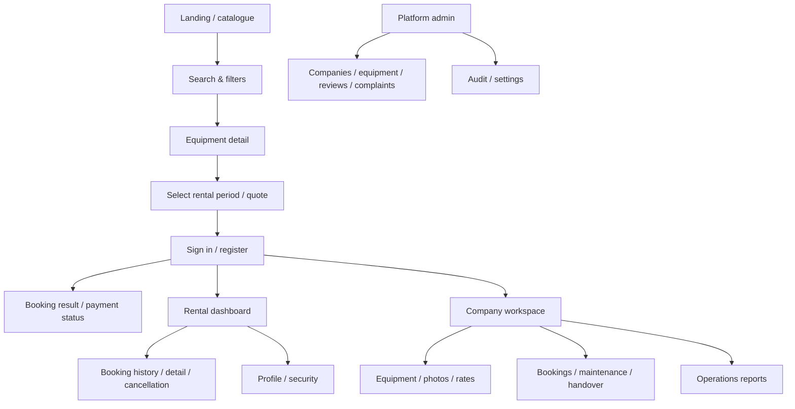

# Sitemap

Pages are planned as routing destinations. Only the catalogue and initial login/booking API shell are part of this first source tranche. Pages not implemented in the frontend must not be represented as complete.
