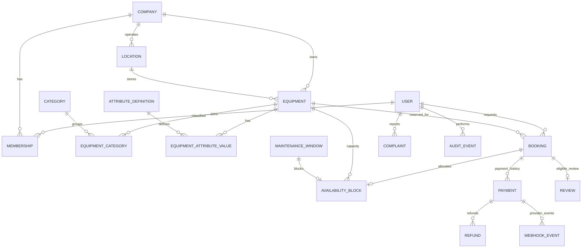

# ER diagram (conceptual)

`AvailabilityBlock` is intentionally the enforcement layer for time allocation. Payment records are planned schema only; actual gateway processing is disabled. SaaS subscription models are deferred until the first pricing hypothesis is validated.
